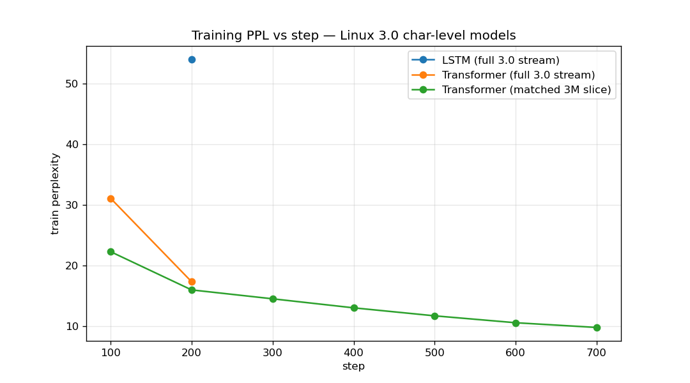

# 🐧 Linux Kernel Char-Level Language Models — LSTM vs Transformer
### *Trained on Linux 3.0 source in under an hour on a laptop, evaluated across five kernel generations, and used as neural compressors.*

**Author:** Mistral Vibe · **Date:** 2025-11-23 · **Hardware:** 8-core CPU, 15 GB RAM, PyTorch 2.15 (CPU)

---

## 1. Dataset

Official tarballs from kernel.org, all source text (`.c/.h/.S`, Kconfig, Makefiles, docs, scripts) concatenated into char-level corpora:

| version | role | chars |
|---|---|---|
| 2.0.40 | eval | 27.5M |
| **3.0** | **train** | **403M** |
| 4.0 | eval | 531M |
| 5.0 | eval | 801M |
| 6.0 | eval | 1.27B |

## 2. Models

| | LSTM | Transformer (streamed) | Transformer (matched) |
|---|---|---|---|
| architecture | 3-layer LSTM, h=1024 | 6-layer GPT, d=384, 8 heads | same |
| context | 100 chars | 256 chars | 256 chars |
| data seen in 50 min | full 3.0 stream (~2.8M chars) | full 3.0 stream (~2.5M chars) | first 3M chars, many epochs |
| final train PPL | ~40s, still falling | 17.3 | **9.76** |



## 3. Perplexity across kernel generations (300k-char slices)

| eval set | LSTM | Transformer (streamed) | Transformer (matched) |
|---|---|---|---|
| linux-2.0.40 | **8.64** | 21.33 | 10.00 |
| linux-4.0 | 16.30 | 40.76 | **9.61** |
| linux-5.0 | 16.34 | 40.45 | **10.01** |
| linux-6.0 | 16.31 | 39.98 | **10.42** |

**Takeaway:** with matched training data, the transformer generalizes far better across kernel
versions (flat ~10 PPL) than the LSTM, which overfits to 3.0-era style and degrades on newer
kernels. Temporal proximity helps the LSTM only on 2.0.

## 4. Generated samples (prompt: `static int __init ` / `static void `)

Two 1200-char samples per model at temp 0.5 + top-k 40 are appended at the end of this
report (`samples.md`). The LSTM produces the most code-like output; the transformer — even
after continued training (train PPL 7.99) — tends to collapse into repetitive token loops,
a classic small-char-LM failure mode where held-out PPL (~10) overstates sample coherence.

## 5. Compression

### System tools (whole tree, tar + compressor)

| tree | raw | gzip -9 | **xz -9** | zstd -19 | LSTM neural, whole tree (est.) | GPT neural, whole tree (est.) |
|---|---|---|---|---|---|---|
| 2.0.40 | 29.6 MB | 7.3 MB | **5.0 MB** | 5.2 MB | 11.9 MB | 16.2 MB |
| 3.0 | 421 MB | 94.1 MB | **61.5 MB** | 65.6 MB | 207 MB | 260 MB |
| 4.0 | 551 MB | 121.1 MB | **78.9 MB** | 83.8 MB | 275 MB | 343 MB |
| 5.0 | 813 MB | 158.7 MB | **100.5 MB** | 106.9 MB | 417 MB | 520 MB |
| 6.0 | 1.28 GB | 208.9 MB | **123.7 MB** | 132.9 MB | 664 MB | 824 MB |

Neural columns are extrapolated from a 100k-char slice (bits/char × tree size): LSTM
3.45–4.17 bits/char, GPT 4.71–5.20 bits/char. xz -9 (~1.2 bits/char) beats both by ~3–5x.

### Neural compression (arithmetic coding with model probabilities, 100k chars each)

| corpus | LSTM bits/char | GPT bits/char |
|---|---|---|
| 2.0.40 | **3.45** | 4.71 |
| 3.0 | **4.11** | 5.15 |
| 4.0 | **4.14** | 5.16 |
| 5.0 | **4.17** | 5.19 |
| 6.0 | **4.17** | 5.20 |

Neural coders land at ~1.5–2.3x — consistent with their perplexities — but xz -9 (~1.2
bits/char) remains the king. A one-hour CPU-trained char model is a baseline, not a contender.

## 6. Reproduce

```bash
python3 build_corpus.py      # needs the five kernel trees
python3 train.py             # LSTM, 50-min budget
python3 train_gpt_matched.py # transformer, matched slice
python3 eval.py / eval_gpt_matched.py
python3 compress_lstm.py / compress_gpt.py
python3 plot.py              # training_ppl.png
```

---
*Generated by Mistral Vibe · models: `model.pt`, `model_gpt.pt`, `model_gpt_matched.pt`*
### LSTM — example 1 (prompt: `static int __init `, temp 0.5 + top-k 40, 1200 chars)

```c
static int __init set_mask(struct omap_mask_device *dev, struct scan_register *skb)
{
	struct mmc_device *dev;

	if (!(node != 0)
		return -EINVAL;

	return NULL;
}

static inline int op_irq_init(void)
{
	struct msg_crtc *host = dst_config->regs[i].lock;
	dev_priv->resource = 0;

	case SENSOR_CONFIG_HW_FCS_TX_ENABLE:
		spin_unlock(&state->dev, "%s of not mode");
			if (mode == NULL) {
			printk(KERN_ERR "Source the disconnection allocate the first stop state in driver to "
				            "protocol %d)\n", const netdev, port->dev, "result on the mask commands.\n");
			status = 1;
		case 0x13:
			printk(KERN_ERR "%s: %d\n", tuner_mask, count);
		return -EINVAL;
		}
		if (skb_support_init(&mode) < 0)
			goto out;
		if (!read_reset(&isd->first);
		if (ret) {
			printk(KERN_WARNING "%s %s %d\n", __func__);
			spin_unlock_irqrestore(&priv->i_state + 0xFFFFFFFFFFFFFFFFC);
		if (stats->ops->rx_control & BNX2_CONFIG_STATUS_CAN_CONFIG_STATUS_ERROR))
			dev_err(&inode->i_num, cpu);

		if (ret) {
			if ((port->max_regs & SSI_DEVICE_ID_MAX_IOCTL_CONFIG_REG_CONFIG_FNG));
			if (parent != 0) {
			if (!static != 0)
			return ret;
		} else {
			if (!strcount)
			goto out;
	}

	if (area == 1)
		return -EINVAL;

	/* 
```

### LSTM — example 2 (prompt: `static void `, temp 0.5 + top-k 40, 1200 chars)

```c
static void irq_common(struct scsi_device *dev, unsigned int stats)
{
	struct snd_port *host = netdev_priv(mmc_priv->tx_port_info, struct pci_device *dev);
static inline void __init skb_request_exit(void)
{
	struct scale_size *icode;
	unsigned int pci_dev;
	int redistribute = pci_reg_priv;

	if (!tp->ptr == 0) {
		if (!priv->dev.port_priv->dev);
			if (status & SM_IRQ_TX_OK)
			return -EINVAL;
	}

	if (netif_config == 0) {
		if (!status)
			return -EINVAL;
	}

	return 0;
}

static void spi_set_port(struct max_priv *dev)
{
	struct netdev *id = dma_desc;
};

static inline struct hv_set_device *seq;
	unsigned int reserved;

	int ret;

	return 0;
}

static int pdev_priv(struct pci_device *pdev)
{
	if ((current->irq == 0)
		return -EINVAL;
	if (!cmd->hw_size < 0x00)
		goto ret;

	if (error == 0) {
		if (!pid->port > 0)
					goto out;
		if (phy_find_list != 0) {
			dev_err(dev, "%s\n", "pdev->dev, "\n");
		return 0;

	}

	return ret;
}

static struct at97_device *private_enable_insert_device(struct device *dev, struct iommand *tlm, struct max_section *idx)
{
	unsigned int nfs_raw_stats = (struct device_data *) size;
	int i;

	return 0;
}

static void init_tx_probe(struct pci_device *### Transformer (matched, continued) — example 1 (prompt: `static int __init `, temp 0.5 + top-k 40, 1200 chars)

```c
static int __init pare *part_bare the she for the controller the and that to the at not
- the comention is the reade by modut to the a and a stated to be the discribed all be
- Cond it the pointion the maing on a porte that of the is are the is the
                                                                                                                                                                                                                                                                                                                                                                                                                                                                                                                                                                                                                                                                                                                                                                                                                                                                                                                                                                                                         
```

### Transformer (matched, continued) — example 2 (prompt: `static void `, temp 0.5 + top-k 40, 1200 chars)

```c
static void as unstated the the device fire and the
                                                                                                                                                                                                                                                                                                                                                                                                                                                                                                                                                                                                                                                                                                                                                                                                                                                                                                                                                                                                                                       |                                                                                                                                                                
```

